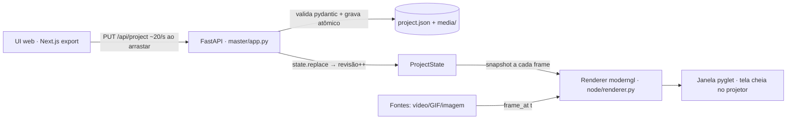

# ProjMap — arquitetura e decisões de engenharia

Este documento registra o **porquê** das escolhas. É atualizado a cada fase.
O estudo que originou as decisões está em
[`docs/projmap/BLUEPRINT.md`](../docs/projmap/BLUEPRINT.md); as decisões
aprovadas (D1–D8) estão em [`docs/projmap/PLANO.md`](../docs/projmap/PLANO.md).

## 1. Visão geral (estado na F1)

Na F1, mestre e saída rodam no **mesmo processo**: o uvicorn fica numa thread e
a janela pyglet na thread principal, como o pyglet exige. Na F2 a janela vira
o processo do nó, e o `ProjectState` local é trocado por mensagens
`apply_config{rev}` vindas da rede. O renderer não muda.

## 2. Espaços de coordenadas

| Espaço | Unidade | Onde aparece |
|---|---|---|
| Projetor | px da saída (ex.: 1920×1080), origem no topo-esquerdo, y para baixo | `surface.warp.base`; é o que o shader usa |
| Foto | px da foto da posição do projetor (normalizado no JSON) | `node.photo_boundary`, vista "Foto" da UI |
| Textura | uv ∈ [0,1]², v para baixo (linha 0 = topo da imagem) | fontes de conteúdo |

- **Foto ↔ projetor.** O usuário marca na foto onde cai o quadro branco
  inteiro do projetor (`photo_boundary`). Isso define a homografia
  `H_foto→proj` (`content/patterns.py::photo_to_projector`, espelhada em
  `ui/app/lib/geometry.ts::photoToProjector`).
- **Edição em qualquer vista.** Tudo que se desenha na foto é convertido para
  pixels do projetor.
- **Mover a área projetada carrega as superfícies.** Elas marcam objetos
  físicos, então o que muda é onde caem no projetor. Por isso a UI aplica
  `H_novo · H_antigo⁻¹` aos quads.
- **Mudar a resolução do projetor escala os quads.** Eles continuam no mesmo
  lugar da parede.

## 3. Warp: homografia exata por pixel

- **Base projetiva.** O quad (TL, TR, BR, BL) define `H: uv → px`
  (`core/geometry.py`, DLT com normalização de Hartley).
- **Avaliação por pixel.** O fragment shader avalia `uv = H⁻¹·(x, y, 1)` para
  cada pixel (`node/shaders/surface.frag`). Interpolar `uv` nos 2 triângulos do
  quad seria afim e produziria a "dobra" diagonal. O teste
  `test_perspectiva_nao_e_afim_a_dobra_diagonal` mostra o tamanho desse erro.
- **Correções entram por cima.** A base é sempre a homografia dos 4 cantos
  (lição do WZRD: spline direto nos cantos entorta retas). Grade e Bézier
  (próximas fases) e o LUT de calibração Gray code (F4) entram como *offset*
  somado ao `uv`, sem substituir a base.
- **Validação nas duas pontas.** Só quads **convexos** são aceitos, na UI (o
  canto "para" no arraste) e no servidor (pydantic). Um quad côncavo ou
  cruzado espelharia a textura.

## 4. Renderer

- **GLSL ES 3.00 com `#version` injetado.** Desktop usa `330 core`; o Pi 5
  (GLES 3.1) usa `300 es` com o mesmo corpo (BLUEPRINT U1).
- **Espaço do projeto separado do framebuffer.** O shader escala de
  `u_viewport` para `u_out_size`, então a mesma cena roda em tela cheia, numa
  janela de preview menor ou num FBO offscreen (testes e futuro modo *baked*).
- **Ordem e mistura.**
  - As superfícies são desenhadas por `z` crescente.
  - Mistura normal: alfa pré-multiplicado (`ONE, ONE_MINUS_SRC_ALPHA`).
  - `add`: `ONE, ONE`. `multiply`: `DST_COLOR, ZERO`, com saída
    `mix(1, cor, a)`.
- **Upload só quando o frame muda.** Cada fonte devolve uma *chave* de frame,
  e a textura só é reenviada quando a chave muda.
- **Mídia quebrada não derruba o show.** A superfície fica magenta e o erro
  vai para o log.
- **Oráculo em CPU.** `mapping/warp.py::render_surface_cpu` reproduz o shader
  em NumPy, com amostragem bilinear igual a `GL_LINEAR`. Os testes exigem que
  GPU e CPU concordem em mais de 99% dos pixels, com tolerância de 12/255.

## 5. Tempo e fontes

- **O tempo vem de fora.** Toda fonte responde `frame_at(t)`, nunca "próximo
  frame". Na F1, `t` é o relógio local; na F2 será o relógio comum
  sincronizado. Com a mesma regra, o mesmo `t` vira o mesmo frame em todos os
  nós.
- **Regra de exibição.** O frame vale de seu `pts` até o próximo (piso, com
  folga de arredondamento de 1e-4 s). GIF e vídeo usam a mesma regra.
- **GIF.** Usa o atraso real de cada frame. Atraso ≤ 10 ms vira 100 ms, como
  nos navegadores.
- **Vídeo (PyAV).**
  - Uma thread decodifica à frente, numa fila curta.
  - O render nunca espera: se o decoder atrasar, repete o último frame.
  - Voltar no tempo (loop) ou pular mais de 1,5 s faz *seek* no keyframe
    anterior e descarta frames até o alvo.

## 6. Persistência

- **O `project.json` é a fonte de verdade.** O esquema é versionado, com
  `migrate()`, e campos desconhecidos são recusados.
- **Escrita atômica.** O arquivo vai para um temporário e depois
  `os.replace`.
- **Mídia endereçada por sha256.** Fica em `media/<sha><ext>`, sem
  duplicatas, e o mesmo hash será conferido pelos nós (F2).
- **Pacote `.pmz`.** É um zip comum. A importação recusa *zip slip* e confere
  o hash de cada mídia.
- **Arquivos só por upload.** A API não aceita mídia nem foto "inventadas" no
  PUT, então o cliente não consegue apontar caminhos arbitrários do disco.

## 7. Desempenho medido (F1)

Medido com `tools/bench.py` neste ambiente de CI/desenvolvimento: **GL por
software (Mesa llvmpipe), 4 vCPUs, sem GPU**. É o pior caso.

| Cenário (saída 1080p30) | Mediana | p95 | Resultado |
|---|---|---|---|
| 4 vídeos 1280×720 | 23,9 ms | 28,9 ms | ✅ dentro de 33,3 ms |
| 2 vídeos 1920×1080 | 21,9 ms | 28,7 ms | ✅ |
| 4 vídeos 1920×1080 | 30,8 ms | 51,7 ms | ❌ acima. CPU dividida entre 4 decoders e a rasterização por software |

**Pendente:** medir numa GPU real (o PC do mestre) e no Pi 5. Otimização já
identificada para quando precisar: enviar os planos YUV direto à GPU e converter
no shader. Isso evita o `swscale` RGBA na CPU e reduz o upload em ~2,7×.

## 8. Segurança

- O mestre escuta em `127.0.0.1` por padrão. Expor na LAN gera um aviso no log
  até o token de pareamento chegar (F2/F6).
- CORS liberado só para `localhost`, para a UI em modo dev.
- Senhas (PJLink, F5) vão só no `.env`. O projeto guarda apenas o nome da
  variável.
